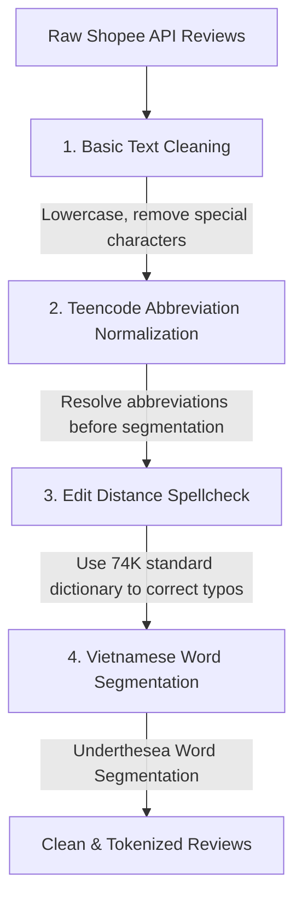

# Shopee Review Data Preprocessing Architecture

This document specifies the Natural Language Processing (NLP) module dedicated to analyzing review comments from the Shopee e-commerce platform. The system adopts a **Hybrid (Mapping Dictionary combined with Lexical Edit Distance)** architecture to optimize performance, perform deep cleaning, correct spelling errors, and execute standardized word segmentation before passing data to downstream classification models (e.g., Sentiment Analysis, Topic Modeling).

---

## 1. Pipeline Architecture

The `ShopeeReviewPreprocessor` class executes a sequential pipeline consisting of 4 core stages to transform raw unstructured data into clean, normalized tokens.

### Detailed Pipeline Specifications:

#### Stage 1: Basic Text Cleaning

* **Objective**: Remove character-level noise.
* **Methodology**:
  * Convert all text to `lowercase`.
  * Use Regular Expressions (Regex) to filter out all punctuation, emojis, and special characters that do not belong to the Vietnamese alphabet. Only alphanumeric characters and single spaces are preserved.
  * Standardize spacing (`whitespace stripping`) and remove redundant line breaks.

#### Stage 2: Teencode Normalization (*Pre-segmentation Strategy*)

* **Objective**: Break down social media slang barriers that disrupt the word segmenter.
* **Methodology**:
  * The system performs a linear scan and matches single words against a static hash map loaded from `teencode.json` (e.g., `sp` $\rightarrow$ `sản phẩm`, `ko` $\rightarrow$ `không`, `mng` $\rightarrow$ `mọi người`).
  * **Importance**: Teencode normalization **must take place before word segmentation**. If abbreviations (such as `sp`) are left unprocessed, the segmentation tool (`underthesea`) cannot recognize the compound semantic entity. Converting them to `sản phẩm` allows the tokenizer to correctly group them into the compound token `sản_phẩm`.

#### Stage 3: Automatic Spellchecking (Edit Distance Spellcheck) (*Vocabulary Preservation Strategy*)

* **Objective**: Correct random typos and misspellings.
* **Methodology**:
  * The system loads the standard Vietnamese dictionary `Viet74K.txt` (~72,500 single and compound words) into memory as a **Hash Set** to guarantee an optimal lookup time complexity of $O(1)$.
  * For each word entity in the text:
    * *Bypass Condition*: If the word is a number, a short string ($\le 2$ characters), or already exists in the standard dictionary Hash Set $\rightarrow$ Keep it unchanged to optimize resources.
    * *Correction Condition*: If the word does not exist in the dictionary (identified as a typo, e.g., `sarn phaamr`), the **Levenshtein Distance** algorithm (implemented via the optimized `difflib.get_close_matches` function) scans for the closest candidates in the standard dictionary to replace it, using a default similarity threshold of `cutoff = 0.85`.

#### Stage 4: Vietnamese Word Segmentation

* **Objective**: Segment single/compound word boundaries in sentences.
* **Methodology**: Once the text has undergone deep cleaning and spelling correction (yielding standard Vietnamese), it is passed to the `underthesea.word_tokenize` model. The output connects compound terms using an underscore (e.g., `"sản phẩm tốt"` $\rightarrow$ `"sản_phẩm tốt"`).

---

## 2. Problem Context & Solution Rationale

Review data on the Shopee e-commerce platform possesses unique characteristics that pose significant challenges to traditional NLP systems:

1. **Extremely High Language Noise Density**: Fast typing habits on mobile devices lead to a heavy presence of teencode, abbreviations, and slang (`k`, `ko`, `sp`, `đc`, `shop`, `mn`).
2. **Unstructured Typographical Errors**: Typing errors, key-sticking, and missing/incorrect Vietnamese diacritics occur randomly due to input methods (Telex/VNI).
3. **High Throughput Requirements**: Crawling yields massive datasets (tens of thousands of rows per product group), requiring fast processing speeds.

To address this problem comprehensively without relying on expensive hardware infrastructure (GPUs), the **Hybrid (Edit Distance + Teencode Dictionary)** model was selected due to its optimal balance between **resource cost, processing speed**, and **practical accuracy**.

---

## 3. In-Depth Analysis & Decision Matrix

To standardize text, the project conducted a detailed evaluation between two common contemporary approaches: the **Hybrid Method (Mathematical Algorithms & Dictionaries)** and the **Deep Learning Method (Deep Learning Seq2Seq)**.

### Comprehensive Technical Comparison

| Evaluation Criteria | Hybrid Method (Edit Distance + Dictionary) *[Selected Solution]* | Deep Learning AI Method (Seq2Seq / Transformers like T5, BARTPho) |
| --- | --- | --- |
| **Contextual Understanding** | **Low - Medium**: Processes words in isolation; cannot distinguish homographs based on surrounding words. | **Very High (Superior)**: Analyzes the context of the entire sentence. For example: recognizes `k` in `"mua k"` as `"không"`, but in `"size k3"` as a product code. |
| **Diacritic Restoration** | **Poor**: Struggles and is prone to misidentification if the original text is completely unmarked. | **Excellent**: Restores natural Vietnamese diacritics based on language sequence probabilities (`"den rat dep"` → `"đèn rất đẹp"`). |
| **Processing Speed (Latency)** | **Extremely Fast (Real-time)**: Powered by basic string comparison operations. Processes thousands of rows in seconds on a standard CPU. | **Slow**: Requires massive matrix calculations. Processing big data on a CPU can take hours. |
| **Resource Requirements (Footprint)** | **Ultra-lightweight**: Dictionary sizes are a few hundred KB. RAM consumption is negligible; no specialized hardware required. | **Very Heavy**: Requires large frameworks (`torch` > 1.5GB, `transformers`). Model weight files range from 200MB to 1GB. Requires a GPU for optimization. |
| **Data Hallucination Risk** | **0%**: Absolute control. Outputs are always explicit, real dictionary entries specified in the standard dictionary. | **Risk Present**: AI may generate hallucinated words or mistranslate technical specifications, product models, or discount codes (e.g., `A12` → `Anh 12`). |
| **Deployability (Production Deployment)** | **Simple**: Pure Python source code, runs independently without library conflicts or hardware driver dependencies (CUDA). | **Complex**: Heavy environment configuration; prone to library version conflicts between DEV and PRODUCTION environments. |

### Core Tradeoffs and Mitigations

1. **Trading Context for Performance**: We trade off the deep contextual capability of Deep Learning for extremely fast batch processing speeds and smooth operation on standard server configurations (CPU-only).
2. **Trading Flexibility for Data Stability**: For e-commerce data, technical specifications (e.g., machine codes, sizes, product model names) are vital. The Hybrid approach completely prevents AI hallucinations, keeping numerical entities and product codes fully intact.
3. **Mitigating Edit Distance Weaknesses with a Hybrid Structure**: A critical weakness of the Edit Distance algorithm is its inability to process very short abbreviations (e.g., the word `k` is 4 edit operations away from `không`, so the algorithm would mistranslate it as `kẻ` or `kệ` which are only 1 edit operation away). The system resolves this by nesting **Stage 2 (Teencode Dictionary)** as a preprocessing filter, handling extreme abbreviations before handing the text over to the Edit Distance algorithm in Stage 3.
